<h1 align="center">Rishab Dey</h1>

## 👋 About me

I transform complex data into intelligent solutions, from predictive models and interactive dashboards to AI-powered applications, with a focus on explainable AI and applied machine learning.

|  |  |
|---|---|
| 🎓 **Education** | M.Sc. Data Science |
| 📍 **Based in** | Dortmund, Germany |
| 🔬 **Interests** | Explainable AI · Time-series modelling · LLM agents · Football analytics |
| 🛠️ **Building** | Source-aware AI research agents, interactive data applications |
| 🌱 **Learning** | RAG · MLOps (MLflow, dbt) · German |
| 💼 **Open to** | Data Scientist · Data Analyst · ML / AI Engineer |

✉️ [Email](mailto:rishabdey.cr7@gmail.com) · 🌐 [Portfolio](https://rishabdey.github.io/)

---

## 💡 What I believe

🔍 A prediction you can't explain is just a guess with good PR  
📉 If a spreadsheet is ruining someone's Monday, it's a dashboard waiting to happen  
⚽ The best way to learn a tool is to point it at something you care about

---

## 🧩 Questions I've Answered with Data

| | The question | What I built |
|:---:|---|---|
| ♻️ | Can sustainability reporting move beyond Excel? | Built a multi-user dashboard automating GHG and KPI reporting for 120 companies across 1,500+ submissions. |
| 🧠 | Can we explain what a neural network learns from hyperspectral data? | Applied Grad-CAM and FusionGrad to identify influential spectral bands in a CNN-LSTM model predicting cocoyam moisture content (R² = 0.87). |
| 📡 | Can a product carry its own data story? | Prototyped a Digital Product Passport using Arduino sensors and a Python dashboard to track temperature, speed, location, and UV. |
| 🌍 | Where does Germany's plastic and rubber trade flow? | Built interactive geospatial visualisations mapping cross-border trade flows to and from Germany. |
| ⚽ | Who stands out across Europe's top five football leagues? | Processed 33,000+ player records into a PostgreSQL database powering an interactive player statistics and comparison app. |
| 🎧 | What can 11 years of listening history reveal? | Analysed 150,000 plays using Power BI, 20+ DAX measures, and drill-through reports to explore listening habits over time. |

## 🛠️ Tech Stack

### Languages & Databases

  

---

### Data Analysis & Visualization

  
  
  
  
  
  
  
  
  
  

---

### Machine Learning & Explainable AI

  
  
  
  

---

### Generative AI & NLP

  
  
  
  
  

---

### Data Engineering & Development

  
  
  
  
  
  

---

<h3> IoT & Other Tools</h3>

  
  
  
  

## 🎓 My Journey

| Period | Experience |
|---|---|
| 2014 – 2018 | 🎓 **B.E. in Electronics Engineering** · University of Mumbai|
| 2019 – 2020 | 📊 **Data Analyst Intern** · Breezeitech Services, Mumbai |
| 2020 – 2026 | 🎓 **M.Sc. in Data Science** · Universität Potsdam, Germany |
| 2023 – 2026 | 🏭 **Data Analyst Student Assistant** · Fraunhofer IML, Dortmund |
| 2026 – Present | 🚀 **Exploring new opportunities** in Data Science, Data Analytics, and Applied AI |

---
## GitHub Activity

<picture>
  <source media="(prefers-color-scheme: dark)" srcset="./profile/stats-dark.svg" />
  <source media="(prefers-color-scheme: light)" srcset="./profile/stats.svg" />
  
</picture>

<picture>
  <source media="(prefers-color-scheme: dark)" srcset="./profile/top-langs-dark.svg" />
  <source media="(prefers-color-scheme: light)" srcset="./profile/top-langs.svg" />
  
</picture>

  

 

## Contribution Snake

<picture>
  <source media="(prefers-color-scheme: dark)" srcset="https://raw.githubusercontent.com/RishabDey/Who-is-Rishab-/output/github-contribution-grid-snake-dark.svg" />
  <source media="(prefers-color-scheme: light)" srcset="https://raw.githubusercontent.com/RishabDey/Who-is-Rishab-/output/github-contribution-grid-snake.svg" />
  
</picture>

